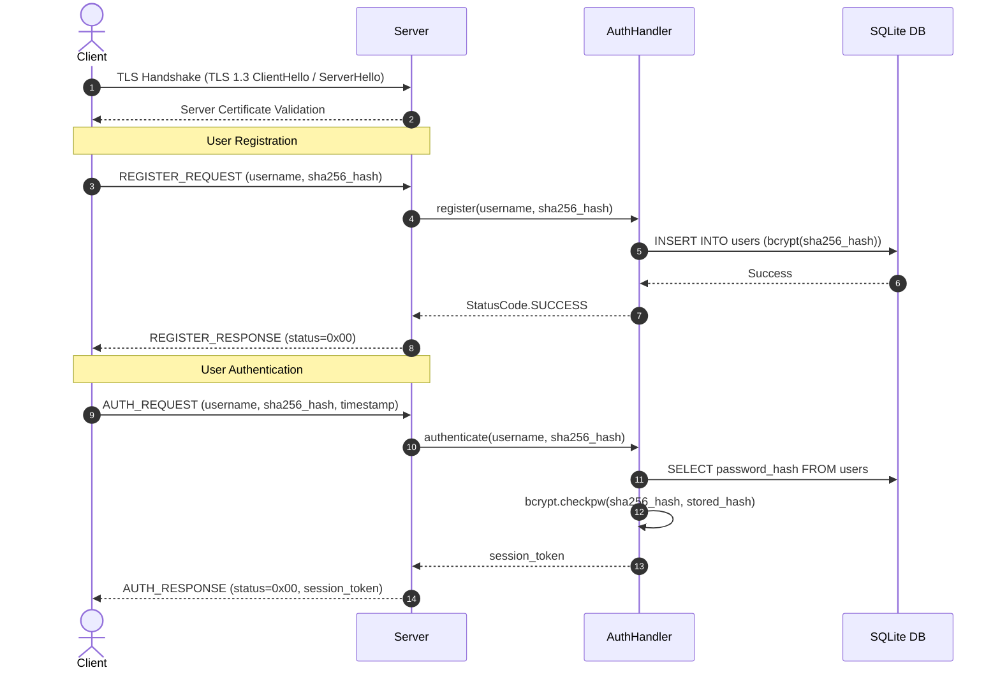
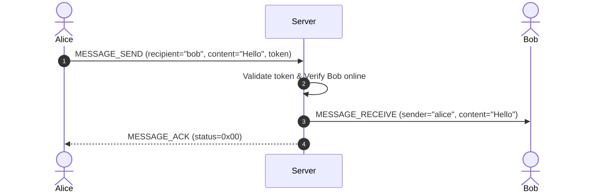
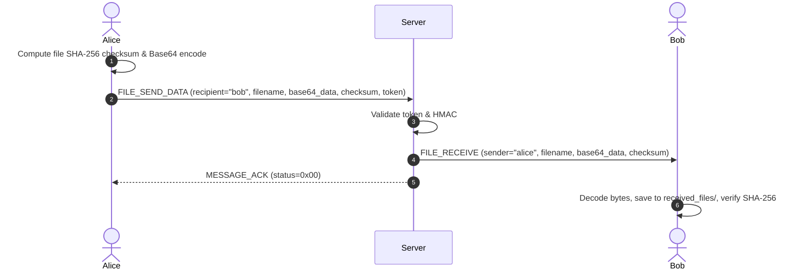

# System Architecture
## Encrypted Client-Server Communication Framework (ECCP)

**Topic:** Secure Client-Server Communication with TLS/SSL  
**Version:** 1.0  
**Authors:** Sarode & Don  

---

## 1. Overview

The Encrypted Client-Server Communication Framework (ECCP) is an enterprise-grade, secure client-server platform built in Python. It enforces layered end-to-end security through modern transport layer encryption (TLS 1.3), cryptographic message authentication codes (HMAC-SHA256), salted password hashing (bcrypt), and ephemeral session management.

```
┌──────────────────────────────────────────────────────────────┐
│                    Application Layer                         │
│   (CLI Client / Modern Tkinter GUI / Multi-Client Server)    │
├──────────────────────────────────────────────────────────────┤
│               Application Protocol Layer (ECCP)              │
│        (Wire Framing, Type Routing, JSON Serialization)      │
├──────────────────────────────────────────────────────────────┤
│                 Message Integrity Layer                      │
│                (HMAC-SHA256 Tamper Detection)                │
├──────────────────────────────────────────────────────────────┤
│               Transport Security Layer (TLS)                 │
│              (TLS 1.2 / 1.3, X.509 Certificates)             │
├──────────────────────────────────────────────────────────────┤
│                 Transport & Network Layer                    │
│                        (TCP/IP)                              │
└──────────────────────────────────────────────────────────────┘
```

---

## 2. High-Level System Architecture

The system consists of three primary subsystems:
1. **Secure Server Subsystem**: Multi-threaded TCP daemon that handles TLS termination, user database persistence, credential authentication, message routing, and offline storage.
2. **Client Subsystem**: Available both as an interactive terminal CLI and as a modern Tkinter desktop GUI, providing authenticated messaging, real-time user discovery, and integrity-verified file transfers.
3. **Common Cryptographic Subsystem**: Shared protocol parser, HMAC engine, password hashing, and session token managers.

```mermaid
graph TD
    subgraph Client Subsystem
        CLI[Terminal Client (client.py)]
        GUI[Tkinter GUI Client (client_gui.py)]
    end

    subgraph Transport Security
        TLS[TLS 1.3 Secure Socket Layer]
    end

    subgraph Server Subsystem
        SS[Secure Server (server.py)]
        AUTH[Auth Handler (auth.py)]
        DB[(SQLite Database: users.db)]
        SM[Session Manager]
    end

    CLI --> TLS
    GUI --> TLS
    TLS --> SS
    SS --> AUTH
    AUTH --> DB
    AUTH --> SM
```

---

## 3. Cryptographic and Security Specifications

### 3.1 Transport Encryption (TLS 1.3)
- **Protocol**: TLS 1.3 (minimum supported TLS 1.2)
- **Certificates**: 2048-bit RSA X.509 certificates generated via internal Certificate Authority (CA)
- **Cipher Suites**: Negotiated by TLS 1.3 (e.g. `TLS_AES_256_GCM_SHA384`, `TLS_CHACHA20_POLY1305_SHA256`)
- **Wireshark Verifiability**: All packets exchanged across the wire are encrypted Application Data records (`0x17`), ensuring zero plaintext exposure of headers or payloads.

### 3.2 Message Integrity (HMAC-SHA256)
Each ECCP frame carries a 32-byte HMAC-SHA256 signature calculated over the frame header, length, message UUID, and payload data using a shared protocol key. Any modification to bytes in transit causes immediate signature mismatch and packet rejection (`StatusCode.CHECKSUM_MISMATCH`).

### 3.3 Password Security & Storage
- **Client Pre-Hash**: Passwords are pre-hashed deterministically with SHA-256 before transmission over the encrypted TLS channel.
- **Server Storage**: Passwords stored in SQLite are hashed using `bcrypt` with work factor 12 and unique 128-bit cryptographically secure random salts.
- **Verification**: Constant-time verification using `bcrypt.checkpw()` prevents timing side-channel attacks.

### 3.4 Session Lifecycle & Replay Protection
- **Token Generation**: 64-character hex strings generated from high-entropy OS randomness (`os.urandom(32)`) and SHA-256.
- **Expiration**: Ephemeral validity window (default 3600 seconds) with automated background cleanup worker threads.
- **Replay Protection**: Each message frame incorporates a unique 16-byte UUID (`message_id`) and nanosecond-resolution timestamp to defeat replay attacks.

---

## 4. Protocol Wire Framing Specification

All messages sent over the TCP socket are prefixed by a 4-byte big-endian length prefix, followed by the ECCP binary frame:

```
 0                   1                   2                   3
 0 1 2 3 4 5 6 7 8 9 0 1 2 3 4 5 6 7 8 9 0 1 2 3 4 5 6 7 8 9 0 1
+-+-+-+-+-+-+-+-+-+-+-+-+-+-+-+-+-+-+-+-+-+-+-+-+-+-+-+-+-+-+-+-+
|       Length Prefix (4B - Big Endian Total Length)            |
+-+-+-+-+-+-+-+-+-+-+-+-+-+-+-+-+-+-+-+-+-+-+-+-+-+-+-+-+-+-+-+-+
|      Protocol Header: 'ECC' (3B)              | Msg Type (1B) |
+-+-+-+-+-+-+-+-+-+-+-+-+-+-+-+-+-+-+-+-+-+-+-+-+-+-+-+-+-+-+-+-+
|              Frame Length (4B - Big Endian)                   |
+-+-+-+-+-+-+-+-+-+-+-+-+-+-+-+-+-+-+-+-+-+-+-+-+-+-+-+-+-+-+-+-+
|                                                               |
+                    Message UUID (16 Bytes)                    +
|                                                               |
+-+-+-+-+-+-+-+-+-+-+-+-+-+-+-+-+-+-+-+-+-+-+-+-+-+-+-+-+-+-+-+-+
|                                                               |
+                    HMAC-SHA256 (32 Bytes)                     +
|                                                               |
+-+-+-+-+-+-+-+-+-+-+-+-+-+-+-+-+-+-+-+-+-+-+-+-+-+-+-+-+-+-+-+-+
|                      JSON Payload Data ...                    |
+-+-+-+-+-+-+-+-+-+-+-+-+-+-+-+-+-+-+-+-+-+-+-+-+-+-+-+-+-+-+-+-+
```

---

## 5. Message Exchange Sequences

### 5.1 User Registration & Login Sequence


### 5.2 Real-Time Encrypted Message Delivery


### 5.3 Secure File Transfer Sequence


---

## 6. Concurrency and Thread Safety

- **Connection Handling**: The server uses a thread-per-client architecture with daemon worker threads.
- **Client Synchronization**: Sockets use explicit `threading.Lock` primitives to prevent race conditions during message packing and transmission.
- **Database Concurrency**: The SQLite engine utilizes `threading.RLock` (Reentrant Lock) and explicit `try ... finally: conn.close()` blocks to prevent locks and deadlocks across concurrent queries.
- **GUI Event Loop**: Tkinter operates on the main thread, while networking and background socket receivers communicate via thread-safe `queue.Queue`.

---

## 7. Threat Modeling and Mitigations

| Threat | Risk Level | ECCP Mitigation Mechanism |
|---|---|---|
| **Eavesdropping / Sniffing** | High | All network traffic wrapped in TLS 1.3 with forward secrecy. |
| **Man-in-the-Middle (MitM)** | Critical | X.509 CA certificate verification on client connection. |
| **Message Tampering** | High | HMAC-SHA256 signature verification over entire frame header and payload. |
| **Replay Attacks** | Medium | Ephemeral session tokens, unique 128-bit UUIDs, and timestamp freshness checks. |
| **Password Database Breach** | High | Work factor 12 bcrypt hashing with unique 128-bit salts. |
| **Brute-Force Login Attacks** | Medium | Account lockout throttling in `AuthHandler` after repeated failed attempts. |
| **Corrupted / Incomplete Files** | Medium | End-to-end SHA-256 file checksum validation before writing to disk. |
